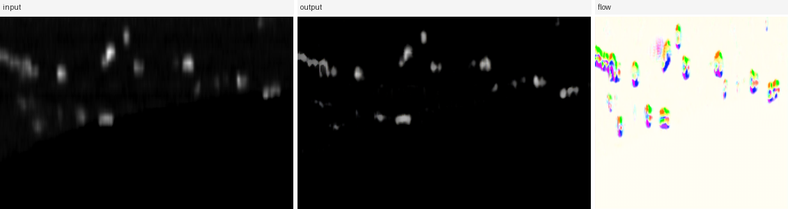
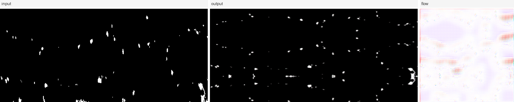

# AxialFlowNet

Geometry-driven image translation for **axial de-stretching of serial sectioning microscopy**.

AxialFlowNet is a **geometric flow-field generator**: a shared ResNet backbone feeds a *flow branch*
that predicts a 2-D displacement field used to warp the input image, plus a *texture-residual branch*
that supplies a bounded pixel-level correction. Training combines the adversarial and
cycle-consistency objectives with an axial-monotonicity penalty, an SSIM/Sobel structural loss, and
total-variation / monotonicity / magnitude regularisation of the predicted flow field.

This repository is the runnable release of the code, weights and example outputs used in the
manuscript. It builds on the
[pytorch-CycleGAN-and-pix2pix](https://github.com/junyanz/pytorch-CycleGAN-and-pix2pix) codebase and
keeps the original BSD-3-Clause license (see `LICENSE` for the derived-work notice).

---

## Contents

| Path | What it holds |
|---|---|
| `models/` | generator, axial multi-scale discriminator, flow head, `AxialFlowNetModel` |
| `data/` | dataset loaders, including the paired `xunliti_paired` one |
| `options/` `util/` | option definitions and helpers (upstream) |
| `scripts/inference.py` | 2-D inference on released weights |
| `scripts/destretch3d.py` | slice-by-slice inference over a 3-D volume |
| `scripts/evaluate_paired.py` | PSNR / SSIM / L1 on paired data |
| `scripts/make_examples.py` | rebuilds the `examples/panels` figures |
| `checkpoints/` | 2 trained runs; each carries `inference_config.json` |
| `examples/` | input → output → flow panels produced by the released weights |
| `docs/METHODS.md` | architecture, losses and training procedure in full |
| `docs/DATA.md` | data provenance, formats and preprocessing |
| `LICENSE`, `CITATION.cff`, `requirements.txt`, `environment.yml` | release metadata |

The microscopy data itself is not redistributed here. `docs/DATA.md` records the formats and
preprocessing so the released weights can be applied to the corresponding acquisitions.

---

## Installation

Python 3.9 with PyTorch 2.4.1.

```bash
conda env create -f environment.yml
conda activate axialflownet
# or, into an existing environment:
python -m pip install -r requirements.txt
```

CUDA is optional; every script here falls back to CPU, only slower.

---

## Quick start

Inference reads the run's `inference_config.json`, so the correct `--texture_bound` is applied
automatically when you point `--ckpt` at a checkpoints directory.

```bash
# 3-axial leaf data (trained with --preprocess resize_and_crop -> square mode)
python scripts/inference.py \
    --ckpt checkpoints/3axial_AxialFlowNet_100ep \
    --input  path/to/leaf_slices \
    --output results/3axial --resize square

# paired mitochondrial data (trained with --preprocess none -> native mode)
python scripts/inference.py \
    --ckpt checkpoints/xianliti_AxialFlowNet_200ep \
    --input  path/to/mitochondria \
    --output results/xianliti --resize native --save_flow
```

`--input` accepts a single image or a directory. `--save_flow` writes the predicted flow field as an
additional `<name>_flow.png`, colour-coded with the Middlebury optical-flow convention
(direction → hue, magnitude → saturation, zero displacement → white).

Overriding the architecture constants by hand is possible but rarely needed:

```bash
python scripts/inference.py --ckpt <ckpt> --input x.png --output o/ \
    --resize square --texture_bound 0.3
```

### 3-D volumes

```bash
python scripts/destretch3d.py \
    --ckpt checkpoints/xianliti_AxialFlowNet_200ep \
    --input data/my_volume.tif --output results/my_volume
```

### Paired evaluation

For paired acquisitions (`trainA`/`trainB` are the same slice before and after de-stretching),
quantitative scoring runs on the train split:

```bash
python scripts/evaluate_paired.py \
    --ckpt checkpoints/xianliti_AxialFlowNet_200ep \
    --data path/to/paired_data --phase train --limit 120 --resize native \
    --sweep_bound 0.15 0.3
```

`--sweep_bound` is exactly how the per-run value in `inference_config.json` was chosen.

---

## Training

```bash
# 3-axial, unpaired
python train.py --dataroot path/to/3axial --name my_3axial_run \
    --model axialflownet --preprocess resize_and_crop \
    --load_size 286 --crop_size 256 --gan_mode vanilla --ngf 64

# paired mitochondrial slices, native resolution
python train.py --dataroot path/to/xunlian-xianliti --name my_xunliti_run \
    --model axialflownet --dataset_mode xunliti_paired --preprocess none
```

`--model axialflownet` registers the architecture-specific flags (`--texture_bound`,
`--flow_mag_threshold`, `--lambda_struct`, …).

`--texture_bound` is a **pure inference/reload constant of the architecture** — it scales the
Tanh in the texture branch — so a checkpoint must be reloaded with the value it was trained with.
Each released run records that value in `inference_config.json`:

| Run | `texture_bound` | `flow_mag_threshold` | Preprocessing |
|---|---|---|---|
| `3axial_AxialFlowNet_100ep` | 0.3 | 0.3 | `--resize square` |
| `xianliti_AxialFlowNet_200ep` | 0.15 | 0.4 | `--resize native` |

`flow_mag_threshold` only appears inside the training-time magnitude penalty and has **no effect at
inference**.

---

## Data

**3-axial leaf tissue** — unpaired axial stretch. Inputs are 8-bit grayscale `L` PNGs of mixed source
size (three sizes dominate: 1024×382, 256×100, 512×249). Trained with `--preprocess resize_and_crop`,
which is why inference for this data uses `--resize square`.

**Paired mitochondrial sections** — `trainA`/`trainB` hold the same slice before/after de-stretching,
16-bit grayscale `I;16` PNGs at native resolution, trained with `--preprocess none` so inference uses
`--resize native`.

See `docs/DATA.md` for the full inventory, provenance and preprocessing details.

---

## Examples

Produced by the released weights; rebuild with `python scripts/make_examples.py`.

**3-axial leaf data (`3axial_AxialFlowNet_100ep`)**



**Paired mitochondrial slices (`xianliti_AxialFlowNet_200ep`)**



---

## Citation

```bibtex
@software{axialflownet,
  title  = {AxialFlowNet: geometry-driven image translation for axial de-stretching
            of serial sectioning microscopy},
  author = {Wu, An},
  year   = {2026},
  note   = {Code and weights release}
}
```

Please also cite the upstream software this release builds on:

```bibtex
@inproceedings{zhu2017cyclegan,
  title     = {Unpaired Image-to-Image Translation using Cycle-Consistent Adversarial Networks},
  author    = {Zhu, Jun-Yan and Park, Taesung and Isola, Phillip and Efros, Alexei A.},
  booktitle = {ICCV},
  year      = {2017}
}
```

---

## Acknowledgements and license

Built on [pytorch-CycleGAN-and-pix2pix](https://github.com/junyanz/pytorch-CycleGAN-and-pix2pix),
Copyright (c) 2017, Jun-Yan Zhu and Taesung Park. Redistribution under the BSD-3-Clause terms kept in
`LICENSE`; the added modules are distributed under the same terms.
