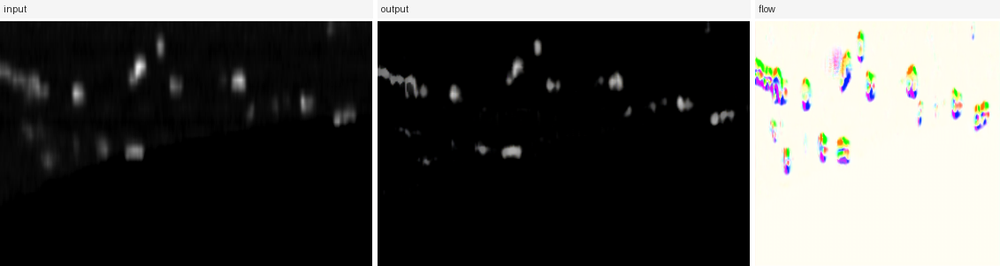
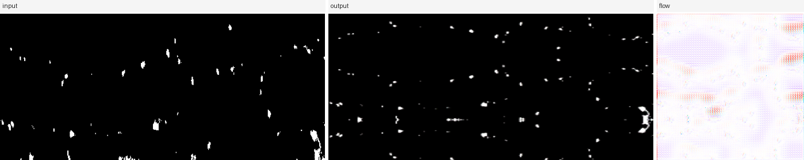

# AxialFlowNet

面向**连续切片显微镜轴向去拉伸**的几何驱动图像转换方法。

AxialFlowNet 是一个**几何流场生成器**:共享的 ResNet 主干输出同时驱动两个分支——*流场分支*预测二维位移场并对输入图像做空间 warp;*纹理残差分支*输出有界的像素级修正量。训练目标在对抗损失与循环一致性之外,叠加了轴向单调性惩罚、SSIM/Sobel 结构保持损失,以及对预测流场的总变分 / 单调性 / 幅度正则化。

本仓库是论文所用代码与生成结果的可运行发布版,训练权重以 release 附件形式提供(见[发布权重](#发布权重))。基于
[pytorch-CycleGAN-and-pix2pix](https://github.com/junyanz/pytorch-CycleGAN-and-pix2pix) 代码库构建,沿用其
BSD-3-Clause 许可(派生作品声明见 `LICENSE`)。

> 英文版见 [README.md](README.md)。

---

## 目录结构

| 路径 | 内容 |
|---|---|
| `models/` | 生成器、轴向多尺度判别器、流场头、`AxialFlowNetModel` |
| `data/` | 数据加载器,含成对数据加载器 `xunliti_paired` |
| `options/` `util/` | 参数定义与工具函数(沿用上游) |
| `scripts/inference.py` | 对发布权重做二维推理 |
| `scripts/destretch3d.py` | 逐切片推理,处理三维体数据 |
| `scripts/evaluate_paired.py` | 在成对数据上计算 PSNR / SSIM / L1 |
| `scripts/make_examples.py` | 重新生成 `examples/panels` 中的对照图 |
| `checkpoints/` | 2 个已训练 run;`inference_config.json`、`train_opt.txt`、`loss_log.txt` 入库,`*.pth` 见 release 附件 |
| `examples/` | 输入 → 输出 → 流场对照图 |
| `docs/METHODS.md` | 完整说明架构、损失函数与训练流程 |
| `docs/DATA.md` | 数据来源、格式与预处理 |
| `LICENSE`、`CITATION.cff`、`requirements.txt`、`environment.yml` | 发布元数据 |

显微镜数据本身不在此仓库中分发。`docs/DATA.md` 记录了格式与预处理方式,便于将发布权重应用于相应的采集数据。

---

## 发布权重

四个 `*.pth` 文件**不入库**:每个 45.6 MB(43.5 MiB),GitHub 拒绝超过 100 MB 的单文件,并建议仓库总量控制在 1 GB 以内(见 `.gitignore` 中的说明)。它们作为
[release `v1.0.0`](https://github.com/Michalehe/AxialFlowNet/releases/tag/v1.0.0) 的附件发布:

```bash
base=https://github.com/Michalehe/AxialFlowNet/releases/download/v1.0.0
for f in 3axial_AxialFlowNet_100ep__latest_net_G_A \
         3axial_AxialFlowNet_100ep__latest_net_G_B \
         xianliti_AxialFlowNet_200ep__latest_net_G_A \
         xianliti_AxialFlowNet_200ep__latest_net_G_B; do
  run=${f%%__*}; stem=${f#*__}
  curl -fL -o "checkpoints/$run/$stem.pth" "$base/$f.pth"
done
```

执行后权重即位于脚本期望的位置:

| release 附件 | 下载后路径 |
|---|---|
| `3axial_AxialFlowNet_100ep__latest_net_G_A.pth` | `checkpoints/3axial_AxialFlowNet_100ep/latest_net_G_A.pth` |
| `3axial_AxialFlowNet_100ep__latest_net_G_B.pth` | `checkpoints/3axial_AxialFlowNet_100ep/latest_net_G_B.pth` |
| `xianliti_AxialFlowNet_200ep__latest_net_G_A.pth` | `checkpoints/xianliti_AxialFlowNet_200ep/latest_net_G_A.pth` |
| `xianliti_AxialFlowNet_200ep__latest_net_G_B.pth` | `checkpoints/xianliti_AxialFlowNet_200ep/latest_net_G_B.pth` |

`inference_config.json` 已在库中,`scripts/inference.py` 会直接从该目录读出该 run 对应的 `--texture_bound`。

---

## 安装

Python 3.9 + PyTorch 2.4.1。

```bash
conda env create -f environment.yml
conda activate axialflownet
# 或安装到既有环境中:
python -m pip install -r requirements.txt
```

CUDA 可选;本仓库所有脚本均可回退到 CPU,只是速度较慢。

---

## 快速开始

推理脚本会读取对应 run 的 `inference_config.json`,因此将 `--ckpt` 指向 checkpoints 目录时,会自动应用正确的
`--texture_bound`。

```bash
# 三轴向叶片数据(训练参数 --preprocess resize_and_crop → 方形模式)
python scripts/inference.py \
    --ckpt checkpoints/3axial_AxialFlowNet_100ep \
    --input  path/to/leaf_slices \
    --output results/3axial --resize square

# 成对线粒体数据(训练参数 --preprocess none → 原生分辨率模式)
python scripts/inference.py \
    --ckpt checkpoints/xianliti_AxialFlowNet_200ep \
    --input  path/to/mitochondria \
    --output results/xianliti --resize native --save_flow
```

`--input` 可接收单张图像或目录。`--save_flow` 会把预测流场额外写成 `<name>_flow.png`,采用 Middlebury
光流上色约定(方向 → 色相,幅度 → 饱和度,零位移 → 白色)。

也可以手动覆盖架构常数,但通常没有必要:

```bash
python scripts/inference.py --ckpt <ckpt> --input x.png --output o/ \
    --resize square --texture_bound 0.3
```

### 三维体数据

```bash
python scripts/destretch3d.py \
    --ckpt checkpoints/xianliti_AxialFlowNet_200ep \
    --input data/my_volume.tif --output results/my_volume
```

### 成对数据评测

对成对采集数据(`trainA`/`trainB` 为同一张切片去拉伸前/后的图像),定量评分在 train 划分上进行:

```bash
python scripts/evaluate_paired.py \
    --ckpt checkpoints/xianliti_AxialFlowNet_200ep \
    --data path/to/paired_data --phase train --limit 120 --resize native \
    --sweep_bound 0.15 0.3
```

`inference_config.json` 中每个 run 的取值,正是用 `--sweep_bound` 扫描选定的。

---

## 训练

```bash
# 三轴向,非成对
python train.py --dataroot path/to/3axial --name my_3axial_run \
    --model axialflownet --preprocess resize_and_crop \
    --load_size 286 --crop_size 256 --gan_mode vanilla --ngf 64

# 成对线粒体切片,原生分辨率
python train.py --dataroot path/to/xunlian-xianliti --name my_xunliti_run \
    --model axialflownet --dataset_mode xunliti_paired --preprocess none
```

`--model axialflownet` 注册该架构专属的参数
(`--texture_bound`、`--flow_mag_threshold`、`--lambda_struct` …)。

`--texture_bound` 是**纯粹的推理 / 重载架构常数**——它缩放纹理分支中的 Tanh,因此 checkpoint 必须用训练时的
取值重载。每个发布的 run 都在 `inference_config.json` 中记录了该值:

| Run | `texture_bound` | `flow_mag_threshold` | 预处理 |
|---|---|---|---|
| `3axial_AxialFlowNet_100ep` | 0.3 | 0.3 | `--resize square` |
| `xianliti_AxialFlowNet_200ep` | 0.15 | 0.4 | `--resize native` |

`flow_mag_threshold` 只出现在训练期的幅度惩罚中,**对推理无影响**。

---

## 数据

**三轴向叶片组织** —— 非成对的轴向拉伸。输入为 8 位灰度 `L` PNG,源尺寸混合(其中三种占主导:
1024×382、256×100、512×249)。训练使用 `--preprocess resize_and_crop`,故该数据推理时用
`--resize square`。

**成对线粒体切片** —— `trainA`/`trainB` 是同一张切片去拉伸前/后的图像,16 位灰度 `I;16` PNG,原生分辨率。
训练使用 `--preprocess none`,故推理时用 `--resize native`。

完整清单、来源与预处理细节见 `docs/DATA.md`。

---

## 示例

由发布权重生成;可用 `python scripts/make_examples.py` 重新生成。

**三轴向叶片数据(`3axial_AxialFlowNet_100ep`)**



**成对线粒体切片(`xianliti_AxialFlowNet_200ep`)**



---

## 引用

```bibtex
@software{axialflownet,
  title  = {AxialFlowNet: geometry-driven image translation for axial de-stretching
            of serial sectioning microscopy},
  author = {Wu, An},
  year   = {2026},
  note   = {Code and weights release}
}
```

同时请引用本发布版所基于的上游软件:

```bibtex
@inproceedings{zhu2017cyclegan,
  title     = {Unpaired Image-to-Image Translation using Cycle-Consistent Adversarial Networks},
  author    = {Zhu, Jun-Yan and Park, Taesung and Isola, Phillip and Efros, Alexei A.},
  booktitle = {ICCV},
  year      = {2017}
}
```

---

## 致谢与许可

基于 [pytorch-CycleGAN-and-pix2pix](https://github.com/junyanz/pytorch-CycleGAN-and-pix2pix) 构建,
Copyright (c) 2017, Jun-Yan Zhu and Taesung Park。在 `LICENSE` 中的 BSD-3-Clause 条款下再分发;
新增模块采用相同条款。
